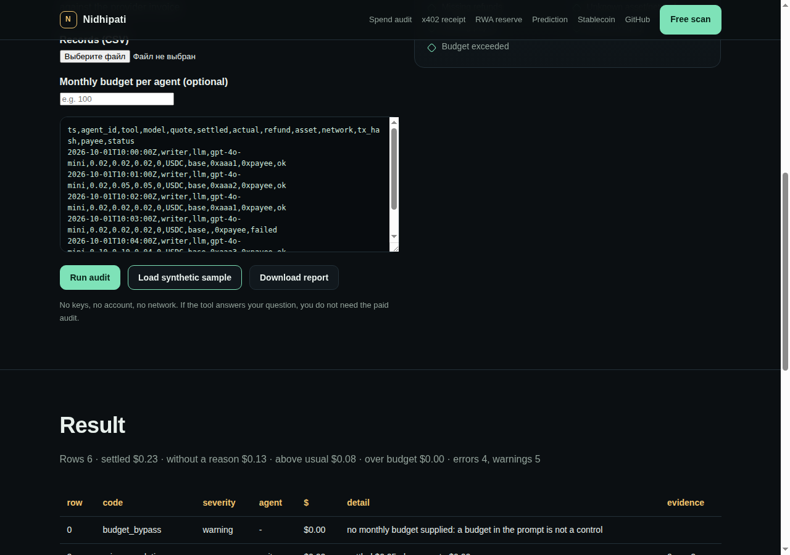

# Nidhipati

**Proof of Spend for AI agents.** A signed receipt that proves what an agent was authorized to pay, what it actually paid, what it used and what was refunded. Not a token, not custody, not another payment rail.

> Рельсы двигают деньги. Nidhipati доказывает, что движение было правильным.

[](https://github.com/mrpkk/nidhipati/actions/workflows/test.yml)
[](https://registry.modelcontextprotocol.io/v0/servers?search=nidhipati)
[](https://glama.ai/mcp/servers/mrpkk/nidhipati)
[](LICENSE)

**Status:** v0.6 — five CLIs, an MCP server, 91 tests, official MCP Registry and Glama listing.

**Site:** https://mrpkk.github.io/nidhipati/  
**Free browser audit (no signup):** https://mrpkk.github.io/nidhipati/free-spend-audit.html  
**BusinessMCP directory:** https://businessmcp.com/mcp-servers/nidhipati  
**Private scan request:** https://github.com/mrpkk/nidhipati/issues/new?template=free-spend-audit.yml



## Reserve and NAV report

For tokenised assets: the issuer's own numbers turned into a NAV with explicit formulas and an
evidence hash per line. The verdict is `backed`, `underbacked`, or `incomplete` — and the ratio
is **refused** when any line has no price, because a number computed over half a reserve is not
a number.

```bash
nidhipati-reserve report examples/reserve.example.json --key keys/private.pem --markdown report.md
```

```
NAV = Σ quantity × price × (1 − haircut) − liabilities
ratio = NAV / supply
```

The statement hash is compared with the file if you provide it. The disclaimer travels inside
the signed document. Details and the partner/legal checklist: [docs/RESERVE-REPORT.md](docs/RESERVE-REPORT.md).

## Resolution evidence

When a market resolves and someone disagrees, the question is whether the resolver's sources
say what the resolver claims and whether they agree with each other. The report answers with
four verdicts — `supported`, `disputed`, `single_source`, `insufficient` — and never picks a
winner.

```bash
nidhipati-resolve report examples/resolve.example.json --key keys/private.pem --markdown report.md
```

Details: [docs/RESOLUTION-EVIDENCE.md](docs/RESOLUTION-EVIDENCE.md).

## Reconciliation

Invoices on one side, transfers on the other. The report names what is closed, what nobody
paid, and what arrived without an invoice — a transfer that duplicates a payment is counted
once, never twice.

```bash
nidhipati-reconcile run examples/invoices.example.csv examples/transactions.example.csv --csv matches.csv
```

Details: [docs/RECONCILIATION.md](docs/RECONCILIATION.md).

## MCP server (for agents, not shells)

The same five checks over the Model Context Protocol: `verify_receipt`, `audit_spend`,
`reserve_report`, `resolve_report`, `reconcile_books`. Input is data, never a file path and never
a network call; the answers are the same reports the CLIs produce, including the refusal to print
a backing ratio when a line has no price.

```json
{"jsonrpc":"2.0","id":1,"method":"tools/call",
 "params":{"name":"reserve_report","arguments":{"reserve":{...}}}}
```

```bash
python3 -m nidhipati_proof.mcp_stdio      # stdio transport
docker build -t nidhipati-mcp . && docker run -i --rm nidhipati-mcp
```

Five tools, all read-only: no custody, no keys, no chain read.

Official MCP Registry: <https://registry.modelcontextprotocol.io/v0/servers?search=nidhipati> (`io.github.mrpkk/nidhipati`, OCI `ghcr.io/mrpkk/nidhipati:0.6.0`).  
Glama listing: <https://glama.ai/mcp/servers/mrpkk/nidhipati>.

## Free scan, and what it costs after

Send records of what your agents spent and get the audit back — no card. The browser audit
needs no account; a human review can go by email or Telegram, no GitHub needed:
email <maxim.pkk@gmail.com> or [Telegram](https://t.me/mrpkk) with the downloaded report
(not raw rows). GitHub is optional:
[open a private scan request](https://github.com/mrpkk/nidhipati/issues/new?template=free-spend-audit.yml);
the issue is public, so ask the question only and never paste records or keys. Paid: first 3
audits **$1,250**; then $2,500 fixed, $1,500/mo retainer, or 20% of verified savings.
$5,000 finding guarantee (identified overcharges, not recovery). Full terms, including what
is *not* included: [docs/OFFER.md](docs/OFFER.md).

In CI, on every run:

```yaml
- uses: mrpkk/nidhipati@v0.2.0
  with:
    records: billing/agent-spend.csv
    policy: billing/policy.json
```

## Quick start

```bash
python3 -m pip install -e .[dev]
python3 -m pytest -q
python3 -m nidhipati_proof.cli verify examples/proof-of-spend.example.json --pubkey <base64url>
```

## What it checks

- schema and canonical JSON;
- Ed25519 signature;
- mandate expiry vs settlement time;
- amount, asset, network, payee;
- `usage.quantity × usage.unit_price` vs payment;
- refund ≤ payment;
- verdict `allow` for a settled payment;
- receipt ID/replay (v0.2 store).


## Agent spend audit

A signed receipt proves one charge. A bill proves a month. The audit reads the records
you already have (CSV or JSON) and names the rows where money left without a reason:

| Finding | What it means |
|---|---|
| `duplicate_charge` | the same receipt twice, or an equal charge within 120s with no receipt at all |
| `price_escalation` | settled above the authorised quote by more than 1% |
| `failed_but_billed` | status failed/error and still charged |
| `missing_refund` | authorised 10, used 4, nothing returned |
| `runaway_loop` | more than 30 calls a minute from one agent |
| `model_overpay` | far above *this agent's own* median for the same tool and model (an estimate) |
| `unknown_asset` / `unknown_network` / `missing_payee` | the record does not say where the money went |
| `budget_bypass` / `budget_exceeded` | no policy file: the limit lives in a prompt; with a policy, the agent is over it |

```bash
python3 -m pip install -e .
nidhipati-spend audit examples/spend-sample.csv --policy examples/spend-policy.example.json
nidhipati-spend audit records.csv --json > report.json
```

Exit code `1` when there is an error — a pipeline can fail on it. The report keeps three
amounts apart on purpose: **spent without a reason** (duplicates, escalation, failed calls,
refunds not returned), **above the usual price** (an estimate, not proof), and **over the
limit** (the money may have been spent on real work).

The sample is synthetic and labelled: it contains every finding once, so you can see what
a report looks like before trusting it with real invoices.

## Honest limits

- v0.1 does **not** verify the on-chain transaction; `onchain_verified=false` is explicit.
- It is not a statutory audit, legal, tax, or investment advice.
- It does not guarantee the service was good; it proves the payment was within mandate.
- No custody, no money transmission, no token.

## Docs

- `SPEC.md` — product, architecture, modules, SEO, monetization, 30/60/90.
- `PROGRESS.md` — slices, acceptance, metrics.
- `docs/PROMPT-AND-IDEAS.md` — prompt and decisions for RAG.
- `docs/SEO-MONETIZATION.md` — keywords, pages, funnel, pricing.
- `docs/LAUNCH-KIT.md` — Show HN, Reddit, Product Hunt, X/LinkedIn copy.
- `docs/DEMO.md` — real commands and sample output.
- `docs/AGENT-SPEND-AUDIT.md`, `docs/RESERVE-REPORT.md`, `docs/RESOLUTION-EVIDENCE.md`, `docs/RECONCILIATION.md` — module rules.
- `schemas/proof-of-spend.schema.json` — v0.1 schema.
- `examples/proof-of-spend.example.json` — example.

## License

Apache-2.0.
